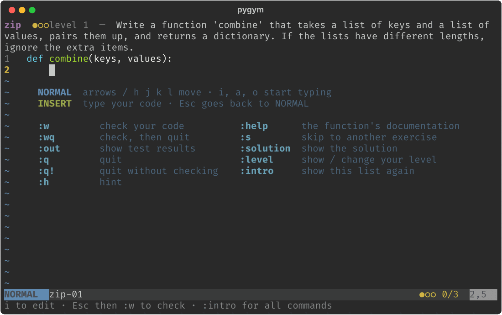
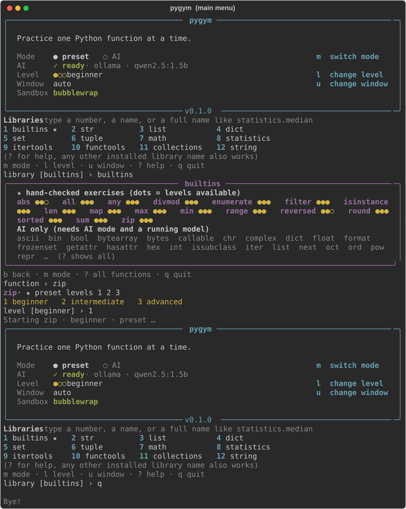

# pygym

Practise one Python function at a time, in your terminal, in Jupyter or in a small window.



*The demo shows real pygym frames: a hand-written `zip` exercise checked with `:w`, the results
window with each test and the `print()` output, the fix, then AI mode writing a new
`statistics.median` exercise with the local model (the progress bar runs in real time).*

```bash
pip install pygym-cityu        # the package name on PyPI; you import it as `pygym`
pygym                          # opens the main menu
```

> Status: **0.2.0, a student project in progress.** Hand-written exercises work fully offline.
> AI mode is experimental: read [Known problems](#known-problems) before you rely on it.

## Start an exercise

| Where | How |
|---|---|
| Terminal, with the menu | `pygym` → choose a library (`builtins`, `statistics`, `numpy`...) → a function → beginner / intermediate / advanced |
| Terminal, directly | `pygym zip`, `pygym statistics.median --level 2`, `pygym zip --mode ai --ui text` |
| Python | `from pygym import exercise; exercise("zip")` (or `exercise("zip", 2, mode="ai")`) |
| Jupyter | `exercise("zip")` in a cell, then write your code in a cell that starts with `%%pygym :w` |

Other commands: `pygym --list` (libraries), `pygym --list statistics` (functions, ★ = has
hand-written exercises), `pygym --status` (settings, AI and sandbox status), `pygym --help`.



## The editor

In a Linux or macOS terminal, exercises open in a small Neovim-style editor. It starts in
NORMAL mode: press `i` to type, `Esc` to stop typing, then a command:

| Command | What it does |
|---|---|
| `:w` | check your code; a results window shows every test, the expected value, your value and your `print()` output |
| `:wq` | check, then quit if it passed |
| `:q` / `:q!` | quit (`:q` refuses if you changed the code since the last check) / quit without checking |
| `:h` | a hint |
| `:help` | the function's own documentation |
| `:s` | skip to another exercise |
| `:solution` | show the solution |
| `:out` | show or hide the results window (`Ctrl-W w` moves into it to scroll) |
| `:level` / `:lv 2` | show or change your level (beginner 1, intermediate 2, advanced 3) |
| `:intro` | show all commands |

After 3 solved exercises at one level, the next one is one level higher. pygym never moves
you down; use `:lv` for that. On Windows the default is a small tkinter window; the line CLI
(`--ui text`) works everywhere.

## Preset and AI mode

- **Preset mode** (default): hand-written exercises for 17 built-ins (`map filter enumerate
  len max min range any all sorted sum zip reversed abs divmod round isinstance`), levels 1-3.
- **AI mode** (`m` in the menu, or `--mode ai`): a small model running **on your own computer**
  writes a new exercise for any function of any installed library. Every exercise is checked
  before you see it (the solution runs in the sandbox, must use the function and fit the
  level), but it **may still be wrong**: it carries an `AI` badge and a warning.

AI mode needs [Ollama](https://ollama.com/download) (a separate program, not a pip package)
and a model:

```bash
ollama pull qwen2.5:1.5b       # about 1 GB; the default model
pygym --status                 # "AI ready" when pygym can reach it
```

Without Ollama, AI mode falls back to the hand-written exercises. Settings live in
`~/.pygym/config.json` (`mode`, `model`, `ai_timeout` = 60 s, `prefetch`...). Details:
[docs/AI_MODE.md](docs/AI_MODE.md). How the prompt is built: [docs/PROMPT_DESIGN.md](docs/PROMPT_DESIGN.md).

## The sandbox

Your code (and the AI's code) runs in a separate process in a fresh temporary folder that is
deleted afterwards. On Linux with bubblewrap it cannot see your home folder, write outside its
folder or use the network; everywhere, a Python audit hook blocks writing or deleting outside
the folder, starting programs and network access. It is built to stop accidents; it is **not**
a security boundary. `pygym --status` shows which level you have.

## Known problems

Found while building 0.2.0; they must be solved before 1.0. Measurements are in
[docs/AI_MODE.md](docs/AI_MODE.md) and [docs/PROMPT_DESIGN.md](docs/PROMPT_DESIGN.md).

1. **AI exercise quality with the default 1.5B model is low.** Intermediate and advanced
   exercises rarely pass the checks (about 3 of 12 in our test), and many that pass are still
   weak: rules the question never states, illogical stories (in the demo above, a median is
   used to count buses), or nonsense expected outputs (`bin(-34)[2:]` gives `'b100010'`, and
   that becomes "correct"). The checks prove the solution runs, not that the question makes
   sense. A bigger model fixes most of it (qwen3.5 9.7B: 4 of 4 sensible), but it needs about
   9 GB of memory and 20-40 s per exercise, too heavy for many student laptops. Not decided yet.
2. **44 hand-written exercises have not been reviewed by a person**
   ([docs/EXERCISE_REVIEW.md](docs/EXERCISE_REVIEW.md)), and 28 of the 49 do not follow the new
   level rules (`python tools/validate_exercises.py --levels`).
3. **The tkinter window (the Windows default) is still the 0.0.0 version**: no results window,
   `:out`, `:level`, progress bar, AI badge or bigger-task question.
   [docs/FRONTEND_GUIDE.md](docs/FRONTEND_GUIDE.md) explains how to add them.
4. **Not tested on real machines**: the editor and the sandbox on Windows (there only the audit
   hook protects, so file and network libraries are refused), macOS `sandbox-exec`, Python 3.9,
   and the progress line in a browser notebook. (The tests pass on Linux with Python 3.10-3.14.)
5. Without bubblewrap, generated code can still **read** your files (not write or send them).
6. Some AI-generated use cases do not fit their function (about half for `zip`).
7. The level is kept only for one session, so a student who always ends with `:wq` never
   levels up.
8. The content check for AI text is a short word list; it misses things like gendered roles.
9. Ctrl-C while the AI writes stops the wait, but the request already sent keeps the model
   busy until it finishes.

## Development

```bash
pip install -e ".[dev]"
pytest                                      # about 1400 tests, no network needed
python tools/validate_exercises.py          # check every hand-written exercise
python tools/validate_exercises.py --fill   # (re)compute expected_outputs from reference solutions
python tools/validate_exercises.py --levels # list exercises that do not follow the level rules
python experiments/prompt_eval.py --help    # compare AI prompts on a real model
python experiments/readme_demo.py           # rebuild docs/media/demo.gif (needs Ollama)
```

## Layout

| Path | Job |
|---|---|
| `src/pygym/session.py` | one practice session: every command (`Session.handle`), levels, background jobs, prefetch |
| `src/pygym/models.py` | `Exercise`, `GradeResult`, `TestResult`, `Response` (the shared contract) |
| `src/pygym/menu.py` | the `pygym` command and the main menu |
| `src/pygym/editor.py`, `ui.py`, `jupyter.py` | the front-ends: terminal editor, line CLI and tkinter, Jupyter magic |
| `src/pygym/style.py` | the shared Rich look |
| `src/pygym/grader.py`, `_runner.py`, `sandbox.py` | checking code in the sandbox |
| `src/pygym/ai/` | AI mode: targets, use cases, prompt and examples, providers, checks, levels, cache |
| `src/pygym/loader.py`, `data/exercises.json` | the hand-written exercises |
| `src/pygym/config.py`, `progress.py` | settings and local progress in `~/.pygym/` |
| `docs/` | AI mode, prompt design, front-end guide, exercise review |

## Releasing (for maintainers)

1. Update `__version__` in `src/pygym/__init__.py` and add an entry to `CHANGELOG.md`.
2. Commit and push to `main`.
3. On GitHub: **Releases → Draft a new release**, choose the tag (e.g. `v0.2.0`), **Publish release**.
4. The `Publish to PyPI` workflow runs the tests, builds, and uploads automatically.

One-time setup: on PyPI add a *Trusted Publisher* (workflow `publish.yml`, environment `pypi`),
and create an environment named `pypi` in the GitHub repo under Settings → Environments.
