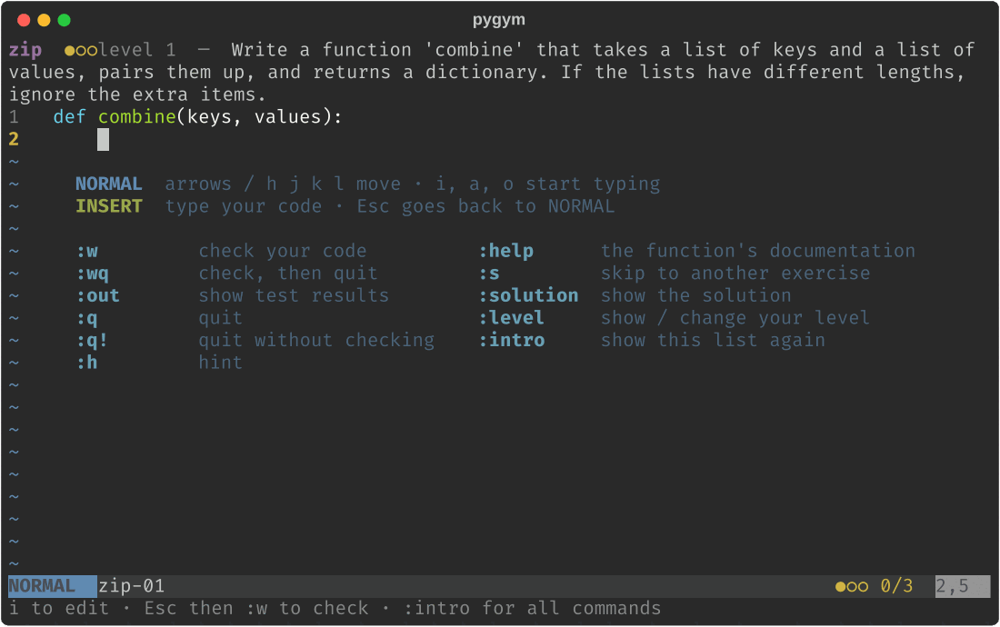
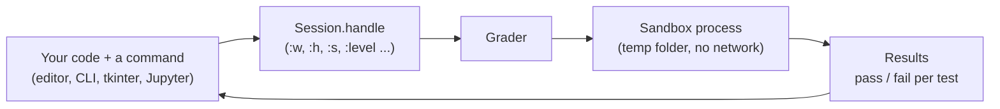
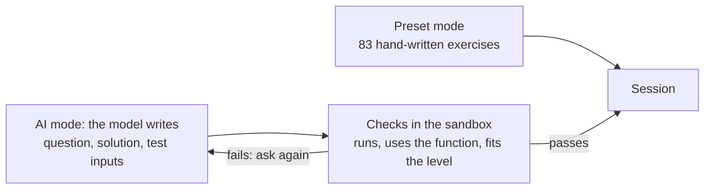
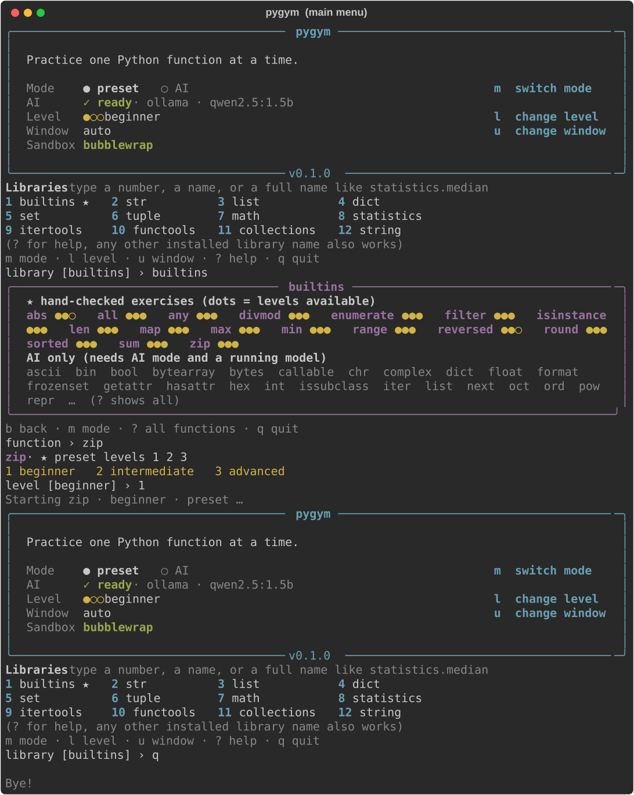
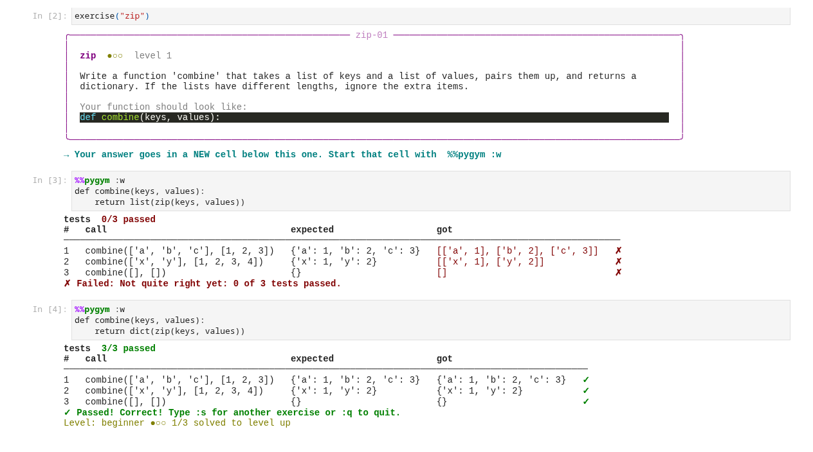
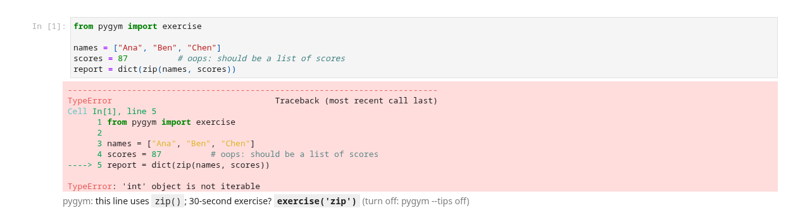
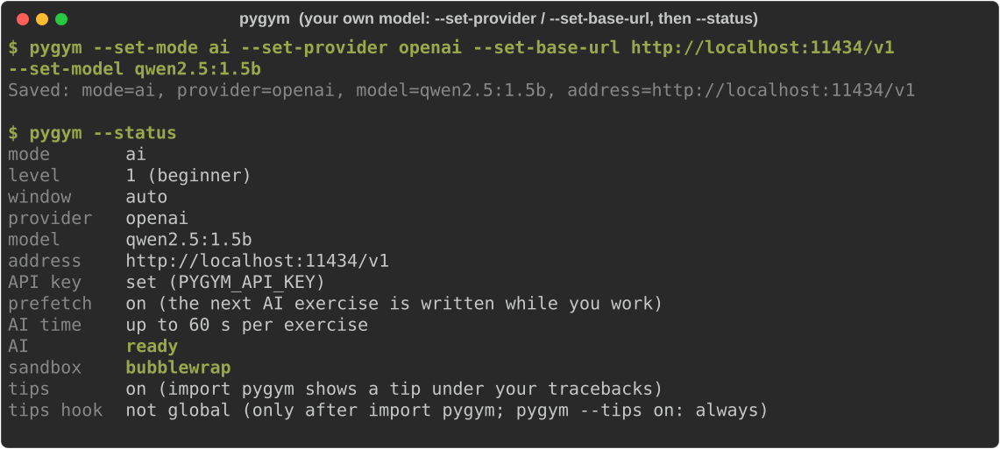

# pygym

[](https://pypi.org/project/pygym-cityu/)
[](#tested-setup)
[](#development)
[](LICENSE)
[](https://github.com/Jcthecoder200/pygym/commits/main)

Practise one Python function at a time: short exercises for built-ins like `zip`, `map` and
`sorted`, in your terminal, in Jupyter or in a small window. When your own code crashes, pygym
points at the built-in on the failing line and offers a 30-second exercise for it.



*Real pygym frames: a hand-written `zip` exercise checked with `:w`, the results window with
each test and the `print()` output, the fix, then AI mode writing a new `statistics.median`
exercise with a local model (the progress bar runs in real time).*

> **Status: 0.3.0, a CityU student project.** Hand-written exercises work fully offline.
> AI mode is experimental: read [Known problems](#known-problems) before you rely on it.

## Why pygym

You are writing code, `zip` does something you did not expect, and the error message does not
help. Usually you would leave your editor, search, read a tutorial and come back. pygym brings
the lesson to where you are coding instead:

- **It starts from using, not from a course.** When your code crashes, the tip under the
  traceback names the built-in on the failing line. One command and you are practising it.
- **You write real code.** Each exercise asks for a small function that must actually use the
  built-in, and it is checked against several tests, not multiple choice.
- **It teaches, it does not grade.** Hints and the solution are there when you ask; retries and
  skips are unlimited; your progress stays on your computer.
- **It is light.** `pip install` and go: one dependency, works offline, in the terminal,
  Jupyter/Colab or a small window. AI mode is optional.

Who it is for: university students learning Python, and anyone who wants to practise one
function at a time.

## Contents

- [Why pygym](#why-pygym)
- [Install](#install)
- [Quick start](#quick-start)
- [Tested setup](#tested-setup)
- [Features](#features)
- [How it works](#how-it-works)
- [Command line](#command-line)
- [Inside an exercise](#inside-an-exercise)
- [Jupyter and Google Colab](#jupyter-and-google-colab)
- [Tips at your error](#tips-at-your-error)
- [Python API](#python-api)
- [AI mode](#ai-mode)
- [Use your own AI model or API key](#use-your-own-ai-model-or-api-key)
- [Settings and environment variables](#settings-and-environment-variables)
- [The sandbox](#the-sandbox)
- [Troubleshooting](#troubleshooting)
- [Known problems](#known-problems)
- [Roadmap](#roadmap)
- [Development](#development)
- [Project layout](#project-layout)
- [More documentation](#more-documentation)
- [Team](#team)
- [License](#license)

## Install

You need **Python 3.9 or newer**. pygym has one dependency, [Rich](https://github.com/Textualize/rich),
which pip installs for you.

```bash
pip install pygym-cityu          # install (upgrade later with: pip install -U pygym-cityu)
```

**The install name and the import name are different.** You install `pygym-cityu` (the name
`pygym` was taken on PyPI), but you import `pygym` and run the command `pygym`:

```python
import pygym                     # right
import pygym_cityu               # wrong: ModuleNotFoundError
```

In Jupyter or Google Colab, install inside the notebook with `%pip install pygym-cityu`.
AI mode needs a model: one more program (Ollama) or a provider with your API key, see
[AI mode](#ai-mode); everything else works without it.

## Quick start

There are three ways in. They all open the same exercises.

**1. From the terminal**

```bash
pygym                  # main menu: choose a library -> a function -> a level
pygym zip              # start a zip exercise straight away
python -m pygym        # the same as `pygym`, if the command is not on your PATH
```

**2. From Python** (a script, the REPL, IDLE)

```python
from pygym import exercise

exercise("zip")                  # beginner level
exercise("sorted", 2)            # intermediate
exercise(zip)                    # the function itself works too
```

**3. In a Jupyter or Colab notebook**

```python
from pygym import exercise
exercise("zip")
```

Then answer in a **new cell** that starts with `%%pygym :w`:

```python
%%pygym :w
def combine(keys, values):
    return dict(zip(keys, values))
```

Every check runs your function against several tests and shows each one: the call, the
expected value, your value and anything you printed.

## Tested setup

| Platform | Python | What was run |
|---|---|---|
| Linux (Fedora 44), with bubblewrap | 3.10 - 3.14 | full test suite (1895 passed, 24 skipped on 3.14), editor, menu, Jupyter kernel, AI mode with Ollama |
| Windows 11 | 3.13 (Microsoft Store), 3.9.13 (python.org) | `tools/real_machine_check.py`, editor keys, tkinter window, sandbox |
| Google Colab | 3.13 | notebook front-end |
| macOS | - | **never run on a Mac.** The code has a macOS path (`sandbox-exec`), but nobody has tried it |

Parts most likely to behave differently on your machine:

| Part | Why | Where to look |
|---|---|---|
| The exercise window | Linux/macOS terminals get the editor, Windows gets a tkinter window, notebooks get cell magics | `src/pygym/ui.py` (`run`), or force one with `--ui text` |
| The sandbox | full isolation needs bubblewrap (Linux) or `sandbox-exec` (macOS); Windows only has the audit hook | `src/pygym/sandbox.py`, `pygym --status` |
| AI mode | needs a running model server; without one pygym falls back to hand-written exercises | `pygym --status`, [docs/AI_MODE.md](docs/AI_MODE.md) |

## Features

- **83 hand-written exercises** for 17 built-ins (`abs all any divmod enumerate filter isinstance
  len map max min range reversed round sorted sum zip`), three levels each: beginner,
  intermediate, advanced. They work offline.
- **AI mode**: a language model writes a new exercise for any function of any installed library
  (`statistics.median`, `str.join`, `numpy.cumsum`...). Each one is checked in the sandbox before
  you see it.
- **Bring your own model**: local Ollama by default, or pick a provider by name (OpenAI,
  Anthropic, Gemini, OpenRouter, Groq, LM Studio, your Claude plan...) and save your key with
  `pygym --set-key`. Any OpenAI-compatible server works too.
- **Tips at your error**: when your code crashes, one line under the traceback suggests an
  exercise for the built-in on the failing line. No AI, no internet.
- **Four front-ends**: a Neovim-style terminal editor, a line-by-line CLI, a tkinter window and
  Jupyter cell magics, all built on the same `Session` backbone.
- **Levels that move**: solve 3 exercises at one level and the next one is a level higher.
- **A sandbox**: your code runs in a separate process, in a temporary folder, with file and
  network access blocked.

## How it works

Every front-end (editor, line CLI, tkinter, Jupyter) is thin: it collects your code and a
command and sends both to one `Session`, which owns all the rules. Checking happens in a
separate sandbox process.



1. **You run a command.** `:w` sends your code to `Session.handle`, the one place where every
   command's rules live. The front-end only shows the `Response` it gets back.
2. **The grader checks your function** in a separate process with a time limit: each test's
   return value is compared with the expected one, and your function must really use the
   built-in (a version without `zip` fails even if the output is right).
3. **You see every test**: the call, the expected value, your value and your `print()` output.
   Three solved exercises at one level move you up a level.

Where exercises come from:



- **Preset mode** reads `data/exercises.json`. Every exercise there is checked by
  `tools/validate_exercises.py`.
- **AI mode** never trusts the model's answers. Its reference solution runs in the sandbox on
  its own test inputs, and the values it returns *become* the expected outputs. Replies that do
  not run, do not use the function or do not fit the level are rejected, and the model is asked
  again until one passes or `ai_timeout` (60 s) runs out; then pygym falls back to the
  hand-written exercises. Accepted exercises are saved in `~/.pygym/generated/`.
- **Tips at your error** need no model at all: pygym reads the traceback and the failing line
  and names the built-ins on it that have exercises.

## Command line

`pygym` with no arguments opens the main menu. Everything else:

| Command | What it does |
|---|---|
| `pygym` | open the main menu |
| `pygym FUNCTION` | start an exercise now: `pygym zip`, `pygym str.join`, `pygym statistics.median` |
| `pygym FUNCTION -l 2` / `--level intermediate` | start at a level: 1/2/3 or beginner/intermediate/advanced |
| `pygym FUNCTION --mode ai` | use AI mode for this run only |
| `pygym FUNCTION --ui text` | choose the window: `auto`, `editor`, `text`, `tk` |
| `pygym --mode ai` (no function) | save AI mode as your default (also works for `--level` and `--ui`) |
| `pygym --set-mode preset` | save the default mode |
| `pygym --set-provider NAME` | save the AI provider: `ollama` (default), `openai`, `anthropic`, `gemini`, `groq`... (see [your own API key](#use-your-own-ai-model-or-api-key)); its address and model go back to the provider's defaults |
| `pygym --set-key NAME` | save an API key for a provider in `~/.pygym/keys.json`; pygym asks for it (hidden), never type it on the command line |
| `pygym --forget-key NAME` | delete a saved key |
| `pygym --providers` | list the providers: key status, default model, who receives the prompt |
| `pygym --set-model NAME` | save the model AI mode uses, e.g. `qwen2.5:3b` (`default` = the provider's own) |
| `pygym --set-base-url URL` | save the AI server's address, e.g. `http://localhost:8080/v1` (`default` = the provider's own) |
| `pygym --list` | list the libraries |
| `pygym --list builtins` | list the functions of one library (★ = has hand-written exercises) |
| `pygym --status` | show your settings, whether AI mode is ready and which sandbox you have |
| `pygym --tips on` / `off` / `status` | turn [tips at your error](#tips-at-your-error) on or off everywhere |
| `pygym --version`, `pygym --help` | version, help |

Keys in the main menu:

| Key | What it does |
|---|---|
| a number or a name | choose a library, then a function, then a level |
| `m` | switch between preset and AI mode (saved) |
| `l` | change the default level |
| `u` | change the window (`auto`, `editor`, `text`, `tk`) |
| `b` | go back one step (at the level prompt type `back`) |
| `?` | help (at the function prompt it also lists every function) |
| `q` | quit (Ctrl-C and Ctrl-D also quit) |



## Inside an exercise

Write a function with the name and signature shown, using the function you are practising.
In a Linux or macOS terminal the exercise opens in a small Neovim-style editor: it starts in
NORMAL mode, press `i` to type, `Esc` to stop typing, then type a command.

| Command | What it does |
|---|---|
| `:w` | check your code; a results window shows every test, the expected value, your value and your `print()` output |
| `:wq` | check, then quit if it passed (if it failed, pygym offers to show the solution) |
| `:q` | quit (refuses if you changed the code since the last check) |
| `:q!` | quit without checking |
| `:h` | a hint |
| `:help` | the documentation of the function you are practising |
| `:s` | skip to another exercise |
| `:solution` | show the solution |
| `:out` | show or hide the results window (`Ctrl-W w` moves into it to scroll) |
| `:level` / `:lv 2` | show or change your level (1 beginner, 2 intermediate, 3 advanced) |
| `:intro` | show all commands |

The same commands work in the line CLI (`--ui text`, type them on their own line) and in
Jupyter (see below). The tkinter window, the default on Windows, has fewer of them for now
(see [Known problems](#known-problems)).

After 3 solved exercises at one level, the next one is one level higher. pygym never moves you
down; use `:lv` for that.

## Jupyter and Google Colab

Start with `exercise("zip")` in a cell. The answer always goes in a **new cell** (the output
has no input box):

| In a cell | What it does |
|---|---|
| `%%pygym :w` + your code | check the code in this cell |
| `%%pygym :wq` + your code | check, and end the exercise if it passed |
| `%pygym :h`, `%pygym :help`, `%pygym :solution` | hint, documentation, solution |
| `%pygym :out` | show the last results again |
| `%pygym :s`, `%pygym :level 2` | another exercise, change the level |
| `%pygym :q` | end the exercise |
| `%load_ext pygym` | tips at your error for this notebook (see below) |



*A real notebook run: the task, a wrong answer (a list instead of a dict, 0/3) and the fix
(3/3). The intro panel that `exercise()` prints first is hidden here to save space.*

## Tips at your error

When your own code crashes, pygym reads the failing line. If it uses a built-in that has an
exercise, one line appears under the normal error:

```text
TypeError: 'int' object is not iterable
pygym: this line uses zip() and len(); 30-second exercise? exercise('zip')
```



*A real notebook run: the cell crashes, and pygym's tip appears under the normal traceback.*

Type that command and you are in the exercise. The tip comes from the traceback and the source
line, not from an AI: it is instant, offline and the same every time. In AI mode, functions of
other libraries count too (`statistics.median()`, `np.mean()`). Methods (`df.mean()`) and your
own functions are never named.

| How | What it does |
|---|---|
| `import pygym` (or `from pygym import exercise`) | tips on for this program, notebook or shell |
| `pygym --tips on` | tips always on, also without `import pygym` |
| `pygym --tips off` | removes that; `import pygym` no longer turns tips on either |
| `pygym --tips status` | shows whether tips are on and where the hook is installed |
| `pygym.tips(False)` / `pygym.tips(True)` | off / on for this session only |
| `%load_ext pygym` / `%unload_ext pygym` | on / off in an IPython or Jupyter session |

Tested on Linux: scripts, the Python REPL (new and classic), the IPython terminal and Jupyter
notebooks (a real kernel). IDLE, VS Code notebooks and Colab use the same hooks but were not
tested by hand; Windows, macOS, the PyCharm console and Spyder not yet. How it works and its
limits: [docs/ERROR_TIPS.md](docs/ERROR_TIPS.md). A demo notebook:
[docs/demo_error_tips.ipynb](docs/demo_error_tips.ipynb).

## Python API

Everything a user or a front-end needs is importable from `pygym`:

```python
import pygym
from pygym import exercise, available_functions, ExerciseUnavailable, Session, tips
```

| Name | What it is |
|---|---|
| `exercise(name, difficulty=None, ui="auto", mode=None)` | start an exercise. `name`: `"zip"`, `"str.join"`, `"statistics.median"` or the function itself. `difficulty`: 1-3 (default 1). `ui`: `"auto"`, `"editor"`, `"text"`, `"tk"`, `"jupyter"`. `mode`: `"preset"`, `"ai"` or `None` (= your saved setting) |
| `available_functions()` | the built-ins that have hand-written exercises: `['abs', 'all', ...]` |
| `ExerciseUnavailable` | the exception raised when there is no exercise for a name |
| `Session(name, difficulty=None, mode=None)` | one practice session without any window: the backbone every front-end uses (see below) |
| `tips(on=True)` | tips at your error on or off for this session |
| `pygym.__version__` | the installed version, e.g. `"0.3.0"` |

### Session: build your own front-end

`Session` holds the rules of an exercise. A front-end only sends commands and shows the answer.

```python
from pygym import Session

s = Session("zip", 1, mode="preset")
print(s.exercise.question_text)        # the task
print(s.exercise.function_signature)   # e.g. 'def combine(keys, values):'

r = s.handle(":w", "def combine(keys, values):\n    return dict(zip(keys, values))\n")
print(r.kind, r.result.passed)         # pass True
print(s.handle(":h").text)             # a hint
s.handle(":q")                         # quit (also stops background work)
```

| Session member | What it does |
|---|---|
| `handle(command, code=None)` | run any command from [the table above](#inside-an-exercise) and return a `Response` |
| `start(command, code=None)` | the same, in the background (returns a `Job`); for commands that may wait for the AI |
| `needs_wait(command)` | True if that command may have to wait for an AI exercise |
| `submit(code)` | check code, return a `GradeResult` (`passed`, `reason`, `tests`, ...) |
| `hint()`, `help()`, `solution()`, `skip()` | the same as `:h`, `:help`, `:solution`, `:s` |
| `level_text()` | the level line shown by `:level` |
| `is_dirty(code)` | True if the code changed since the last check |
| `close()` | stop background work; call it if you never send `:q` |
| `exercise`, `level`, `notice` | the current `Exercise`, its level, and a one-line note to show (e.g. the AI warning) |

`Response` (from `handle`) has `text`, `kind` (`"pass"`, `"fail"`, `"hint"`, ...), `result`
(a `GradeResult` after a check) and flags the front-end obeys: `quit`, `ask_reveal`,
`clear_code`, `ask_bigger`. The full contract, with a tkinter example:
[docs/FRONTEND_GUIDE.md](docs/FRONTEND_GUIDE.md).

### Other modules

| Module | Use |
|---|---|
| `pygym.config` | `load()` -> `Settings`, `save(settings)`: read and write `config.json` from code |
| `pygym.tips` | `enable_global()`, `disable_global()`, `global_status()` (what `pygym --tips` uses), `set_tips(on)` |
| `pygym.menu` | `main(argv)`: the `pygym` command, callable from Python |

## AI mode

- **Preset mode** (the default): the 83 hand-written exercises. Offline.
- **AI mode** (`m` in the menu, `--mode ai`, or `exercise(..., mode="ai")`): a language model
  writes a new exercise for any function of any installed library. Before you see it, the
  solution runs in the sandbox, must use the function and must fit the level. It **may still be
  wrong**, so it carries an `AI` badge and a warning.

By default AI mode uses [Ollama](https://ollama.com/download), which runs the model on your own
computer. Ollama is a separate program, not a pip package:

```bash
ollama pull qwen2.5:1.5b       # about 1 GB; the default model
pygym --status                 # "AI ready" when pygym can reach it
pygym --set-model qwen2.5:3b   # optional: use another model you pulled
```

To use a cloud API (OpenAI, Anthropic, Gemini, OpenRouter, Groq), LM Studio or your Claude plan
instead, see [Use your own AI model or API key](#use-your-own-ai-model-or-api-key).
Without a reachable model, AI mode falls back to the hand-written exercises. How it works:
[docs/AI_MODE.md](docs/AI_MODE.md). How the prompt is built: [docs/PROMPT_DESIGN.md](docs/PROMPT_DESIGN.md).

## Use your own AI model or API key

Instead of Ollama you can pick another provider by name. pygym knows its address and a default
model, so you only choose the provider and give it a key.

| Provider | What it is | Key variable | Default model | Runs |
|---|---|---|---|---|
| `ollama` | Ollama on your computer (the default) | none | `qwen2.5:1.5b` | your computer |
| `lmstudio` | LM Studio's local server | none | the model loaded in LM Studio | your computer |
| `openai-compatible` | any OpenAI-compatible server: llama.cpp, vLLM, Ollama's `/v1`, a hosted API | `PYGYM_API_KEY` (if the server wants one) | you choose | where you point it |
| `openai` | OpenAI API | `OPENAI_API_KEY` | `gpt-6-luna` | cloud |
| `anthropic` | Anthropic API (Claude models) | `ANTHROPIC_API_KEY` | `claude-haiku-5-5` | cloud |
| `gemini` | Google Gemini API (has a free tier) | `GEMINI_API_KEY` or `GOOGLE_API_KEY` | `gemini-3.8-flash` | cloud |
| `openrouter` | OpenRouter: many models with one key | `OPENROUTER_API_KEY` | `openrouter/auto` | cloud |
| `groq` | Groq API: fast open models (has a free tier) | `GROQ_API_KEY` | `openai/gpt-oss-20b` | cloud |
| `hermes` | the Hermes subscription proxy (your Nous Portal login) | none | `stepfun/step-3.7-flash:free` | a proxy on your computer, the model in the cloud |
| `hermes-agent` | the Hermes API server (your whole Hermes agent, slower) | `API_SERVER_KEY` (optional) | `hermes-agent` | a server on your computer, the model where your agent has it |
| `claude-code` | your Claude plan through the Claude Code command (no API key) | none (your Claude login) | `sonnet` | cloud |

Other names also work: `custom` = `openai-compatible`, `google` = `gemini`, `claude` =
`claude-code`, `lm-studio` = `lmstudio`. Model names change over time: the defaults are
suggestions that worked in November 2026. Choose another with `pygym --set-model NAME`.

**1. Choose the provider.** Its address and default model are filled in; an address or model
you set for the old provider is not carried over.

```bash
pygym --set-mode ai --set-provider groq
```

**2. Give it your key.** `--set-key` asks for the key and does not show it while you paste.
It is saved in `~/.pygym/keys.json`, which only you can read (file mode 600 on Linux and
macOS; on Windows the file is protected by being in your user folder). Never type the key on
the command line: it would stay in your shell history, so pygym refuses it there.

```bash
pygym --set-key groq                     # paste the key, press Enter
printf '%s\n' "$MY_KEY" | pygym --set-key groq   # or pipe it in (scripts)
pygym --forget-key groq                  # delete the saved key
```

You can also use the provider's environment variable instead (it wins over a saved key):

```bash
export GROQ_API_KEY="gsk_..."            # Linux / macOS (add it to ~/.bashrc to keep it)
```

```powershell
$env:GROQ_API_KEY = "gsk_..."            # Windows PowerShell, this window only
setx GROQ_API_KEY "gsk_..."              # Windows, for new windows from now on
```

```python
import os; os.environ["GROQ_API_KEY"] = "gsk_..."   # Colab / Jupyter, before exercise(...)
```

`PYGYM_API_KEY`, the one key of pygym 0.2 and 0.3.0, still works for every provider that takes
a key, after the provider's own variable and the saved key. A key is never written to
`config.json`, never printed, and never passed to the sandbox that runs your code.

**3. Check it**: `pygym --status` shows the provider, its address and model, where the key comes
from (`key saved (keys.json)` or `key set (GROQ_API_KEY)`, never the key itself), who receives
the prompt, and `AI ready`. If it is not ready it says what to do, for example
`no API key for Groq: pygym --set-key groq, or set GROQ_API_KEY`. For a cloud provider
`--status` asks the server whether it accepts the key (a free request, no model call), so a
wrong key shows here as `Groq refused the API key (HTTP 401)`. The menu itself never waits on
the internet: there a cloud provider counts as ready once a key is set.

`pygym --providers` lists every provider with its key status, default model and who receives
the prompt. It makes no network calls.

**Your own OpenAI-compatible server** (llama.cpp, vLLM, a hosted API pygym has no name for):
give the address, including `/v1`, and the model name the server uses.

```bash
pygym --set-provider openai-compatible --set-base-url http://localhost:8080/v1 --set-model NAME
```

Ollama also speaks this API at `http://localhost:11434/v1`. `pygym --set-provider ollama`
switches back to Ollama's own API. `--set-model default` and `--set-base-url default` go back to
the provider's defaults. The setting of 0.3.0, `--set-provider openai` with an address that is
not OpenAI's, still works: pygym reads it as `openai-compatible` and `--status` says so. The
server should support JSON-schema output; if it refuses that (or `max_tokens`, `temperature`,
`seed`), pygym asks once more without it and remembers.



*A real run against Ollama's OpenAI-compatible address with a dummy key.*

Instead of the flags you can edit `~/.pygym/config.json` (on Windows
`C:\Users\<you>\.pygym\config.json`; fields you leave out keep their defaults; `""` for
`model` or `base_url` means the provider's default):

```json
{
  "mode": "ai",
  "provider": "anthropic",
  "base_url": "",
  "model": ""
}
```

or do it from Python:

```python
from pygym import config
s = config.load()
s.mode, s.provider, s.base_url, s.model = "ai", "anthropic", "", ""
config.save(s)
```

**Privacy.** The **prompt** goes to the provider: the function's name, its documentation and
short descriptions of earlier exercises for that function. **Your code is never sent.** With
`ollama`, `lmstudio`, or `openai-compatible` at a `localhost` address, nothing leaves your
computer. The `--providers` table and `--status` name who receives the prompt.

- Cloud APIs (`openai`, `anthropic`, `gemini`, `openrouter`, `groq`) bill your account or use
  your free tier per request. OpenRouter passes the prompt on to the model's maker.
- `hermes` runs on your computer but forwards the prompt to Nous Research and the model's
  provider. Free models end in `:free`; paid ones use your Nous Portal credits.
  `hermes-agent` runs your whole Hermes agent for each exercise.
- `claude-code` runs the `claude` command on your computer (install Claude Code and run
  `claude` once to log in). pygym starts it in an empty temporary folder with no tools, no MCP
  servers and no saved session, and removes `ANTHROPIC_API_KEY` from its environment so your
  plan is used, not API billing. Each exercise uses some of your plan's usage limits.

## Settings and environment variables

Settings live in `~/.pygym/config.json` (or `$PYGYM_HOME/config.json`). The menu and the
`--set-*` flags write it; you can also edit it by hand.

| Field | Default | Meaning |
|---|---|---|
| `mode` | `"preset"` | `"preset"` or `"ai"` |
| `level` | `1` | the starting level: 1, 2 or 3 |
| `provider` | `"ollama"` | `ollama`, `openai-compatible`, `lmstudio`, `openai`, `anthropic`, `gemini`, `openrouter`, `groq`, `hermes`, `hermes-agent` or `claude-code` (`pygym --providers`). `"openai"` with an address that is not OpenAI's is read as `openai-compatible` |
| `model` | `"qwen2.5:1.5b"` | the model name for that provider; `""` = the provider's default |
| `base_url` | `"http://localhost:11434"` | where the model server is; `""` = the provider's default |
| `ui` | `"auto"` | `"auto"`, `"editor"`, `"text"` or `"tk"` |
| `prefetch` | `true` | write the next AI exercise in the background while you work |
| `ai_timeout` | `60` | seconds the AI may spend on one exercise (10-300) |
| `ai_self_review` | `false` | the model reviews its own reply once (twice as slow, measured no better with the default model) |
| `tips` | `true` | tips at your error |

A broken or missing file never stops pygym: bad values fall back to their defaults. API keys are
never in `config.json`: `pygym --set-key` saves them in `keys.json` next to it (only you can
read it).

| Environment variable | Effect |
|---|---|
| `OPENAI_API_KEY`, `ANTHROPIC_API_KEY`, `GEMINI_API_KEY` (or `GOOGLE_API_KEY`), `OPENROUTER_API_KEY`, `GROQ_API_KEY`, `API_SERVER_KEY` (hermes-agent) | the provider's API key; wins over a key saved with `--set-key` |
| `PYGYM_API_KEY` | API key for `openai-compatible`, and the last fallback for every provider that takes a key |
| `PYGYM_HOME` | folder for settings, saved keys (`keys.json`), progress and saved AI exercises (default `~/.pygym`) |
| `PYGYM_NO_AI=1` | AI mode off completely, no network at all (offline classes, tests) |
| `PYGYM_NO_TIPS=1` | no tips at your error |
| `PYGYM_SANDBOX=audit-hook` | switch off the operating-system layer of the sandbox |

## The sandbox

Your code (and the AI's code) runs in a separate process, in a fresh temporary folder that is
deleted afterwards. On Linux with bubblewrap it cannot see your home folder, write outside its
folder or use the network. Everywhere, a Python audit hook blocks writing or deleting outside
the folder, starting programs and network access. It is built to stop accidents; it is **not**
a security boundary. `pygym --status` shows which level you have.

## Troubleshooting

| Problem | Fix |
|---|---|
| `ModuleNotFoundError: No module named 'pygym_cityu'` | import `pygym`, not `pygym_cityu` (see [Install](#install)) |
| `pygym: command not found` | use `python -m pygym`, or add pip's script folder to your PATH |
| `No module named 'pygym'` in Jupyter | install into the notebook's own Python: `%pip install pygym-cityu`, then restart the kernel |
| AI mode shows hand-written exercises | AI is not ready: `pygym --status` says why; start Ollama, or check your key and the address (`--set-base-url`, with `/v1`) |
| `no API key for ...` | `pygym --set-key NAME` (paste the key), or set the variable it names; then `pygym --status` |
| `... refused the API key (HTTP 401)` | the key is wrong or expired. `pygym --status` shows where it comes from: an environment variable wins over a saved key |
| `rate limit or no credits left (HTTP 429)` | wait a minute, check your account's credits, or choose a cheaper or free model (`--set-model`) |
| `Claude Code is not logged in` / `not installed` | install Claude Code and run `claude` once to log in, or choose another provider |
| `unknown AI provider` | `pygym --providers` lists the names |
| AI exercises are slow or strange | try another model (`pygym --set-model ...`); see [Known problems](#known-problems) |
| The editor looks wrong in your terminal | use the line CLI: `pygym zip --ui text` |
| No exercise for a function | in preset mode only the 17 built-ins above have exercises; use AI mode for the rest |

## Known problems

To be solved before 1.0. Measurements are in [docs/AI_MODE.md](docs/AI_MODE.md) and
[docs/PROMPT_DESIGN.md](docs/PROMPT_DESIGN.md).

1. **AI exercise quality with the default 1.5B model is low.** Intermediate and advanced
   exercises rarely pass the checks (about 3 of 12 in our test), and many that pass are still
   weak: rules the question never states, illogical stories (in the demo above, a median is
   used to count buses), or nonsense expected outputs. The checks prove the solution runs, not
   that the question makes sense. A bigger model fixes most of it (qwen3.5 9.7B: 4 of 4
   sensible), but it needs about 9 GB of memory and 20-40 s per exercise.
2. **78 hand-written exercises have not been reviewed by a person**
   ([docs/EXERCISE_REVIEW.md](docs/EXERCISE_REVIEW.md)), and 28 of the 83 do not follow the newer
   level rules (`python tools/validate_exercises.py --levels`).
3. **The tkinter window (the Windows default) is still the 0.0.0 version**: no results window,
   `:out`, `:level`, progress bar, AI badge or bigger-task question.
   [docs/FRONTEND_GUIDE.md](docs/FRONTEND_GUIDE.md) explains how to add them.
4. **Never run on macOS.** On Windows only the audit hook protects (file and network libraries
   are refused) and the memory limit is not enforced.
5. Without bubblewrap, generated code can still **read** your files (not write or send them).
6. Some AI-generated use cases do not fit their function (about half for `zip`).
7. The level is kept only for one session, so a student who always ends with `:wq` never
   levels up.
8. The content check for AI text is a short word list; it misses things like gendered roles.
9. Ctrl-C while the AI writes stops the wait, but the request already sent keeps the model
   busy until it finishes.
10. **Not every provider has written a real exercise yet.** A real exercise was generated with
    `ollama`, `openai-compatible` (Ollama's `/v1` address) and `claude-code` (model `haiku`).
    For `openai`, `anthropic`, `gemini`, `openrouter` and `groq` only the key check ran against
    the real API (a made-up key is reported as refused); their exercise requests were tested
    with fake servers, as were `hermes`, `hermes-agent` and `lmstudio`. The default model names
    are suggestions and may change.

## Roadmap

Planned, not built yet:

- Provider, model and key settings inside the main menu (today: the `--set-*` flags or
  `config.json`).
- A tkinter window with everything the terminal editor has (see Known problems 3).

## Development

```bash
git clone https://github.com/Jcthecoder200/pygym.git
cd pygym
python -m venv .venv && source .venv/bin/activate   # Windows: .venv\Scripts\activate
pip install -e ".[dev]"

pytest                                      # 1895 tests, no network needed (about 2 minutes)
python tools/validate_exercises.py          # check every hand-written exercise
python tools/validate_exercises.py --fill   # (re)compute expected_outputs from reference solutions
python tools/validate_exercises.py --levels # list exercises that do not follow the level rules
python tools/check_py39.py                  # static check that the code still runs on Python 3.9
python tools/real_machine_check.py          # self-reporting checks for Windows, macOS, Python 3.9
python experiments/prompt_eval.py --help    # compare AI prompts on a real model
python experiments/readme_demo.py           # rebuild docs/media/demo.gif (needs Ollama)
```

### Releasing (for maintainers)

1. Update `__version__` in `src/pygym/__init__.py` and add an entry to `CHANGELOG.md`.
2. Commit and push to `main`.
3. On GitHub: **Releases -> Draft a new release**, choose the tag (e.g. `v0.3.0`), **Publish release**.
4. The `Publish to PyPI` workflow runs the tests, builds and uploads automatically.

One-time setup: on PyPI add a *Trusted Publisher* (workflow `publish.yml`, environment `pypi`),
and create an environment named `pypi` in the GitHub repo under Settings -> Environments.

## Project layout

```text
src/pygym/
  __init__.py           exercise(), tips, the public names
  __main__.py           python -m pygym
  menu.py               the pygym command and the main menu
  session.py            one practice session: every command (Session.handle), levels, background jobs
  models.py             Exercise, GradeResult, TestResult, Response (the shared contract)
  editor.py             front-end: the Neovim-style terminal editor
  ui.py                 front-ends: line CLI and tkinter window; picks one for ui="auto"
  jupyter.py            front-end: the %%pygym cell magic
  style.py              the shared Rich look
  tips.py               tips at your error
  grader.py             checks code against the tests
  _runner.py            runs code inside the sandbox process
  sandbox.py            bubblewrap / sandbox-exec / audit hook
  loader.py             loads the hand-written exercises
  data/exercises.json   the 83 hand-written exercises
  config.py             settings in ~/.pygym/config.json
  progress.py           local progress in ~/.pygym/
  ai/                   AI mode: targets, use cases, prompt, examples, providers, checks, levels, cache
  ai/registry.py        the AI providers: names, addresses, key variables, default models
  ai/keys.py            API keys: environment variables and ~/.pygym/keys.json
tests/                  pytest suite
tools/                  exercise validator, Python 3.9 check, real-machine checks
experiments/            throwaway trials, not part of the package
docs/                   design notes and guides (below)
```

## More documentation

| Document | For |
|---|---|
| [docs/AI_MODE.md](docs/AI_MODE.md) | how AI mode works, its checks, settings and privacy |
| [docs/PROMPT_DESIGN.md](docs/PROMPT_DESIGN.md) | what is sent to the model and how it was measured |
| [docs/ERROR_TIPS.md](docs/ERROR_TIPS.md) | how tips at your error work and their limits |
| [docs/FRONTEND_GUIDE.md](docs/FRONTEND_GUIDE.md) | building or fixing a front-end on top of `Session` |
| [docs/EXERCISE_REVIEW.md](docs/EXERCISE_REVIEW.md) | the checklist for reviewing hand-written exercises |
| [docs/HANDOFF.md](docs/HANDOFF.md) | real-machine testing notes (Windows, Colab) |
| [experiments/README.md](experiments/README.md) | the experiment scripts |
| [CHANGELOG.md](CHANGELOG.md) | what changed in each version |

## Team

Made by students of City University of Hong Kong:

- Nurassyl
- Julian
- Jason
- Miras
- Ablaikhan

Commit history: [contributors](https://github.com/Jcthecoder200/pygym/graphs/contributors).

## License

MIT, see [LICENSE](LICENSE).
